<div align="center">

# LifePulse — Blood Donor & Blood Bank Management Portal

**A centralized, production-deployed full-stack clinical platform connecting voluntary blood donors, emergency requesters, and blood bank administrators with real-time ABO/Rh inventory tracking, privacy-preserving donor discovery, and atomic stock fulfillment.**

[](https://lifepulse-ivory.vercel.app/)
[](https://blood-bank-portal-backend.onrender.com/api/)
[](https://blood-bank-portal-backend.onrender.com/health/)

<br/>

[](https://www.djangoproject.com/)
[](https://www.django-rest-framework.org/)
[](https://www.python.org/)
[](https://developer.mozilla.org/en-US/docs/Web/JavaScript)
[](https://developer.mozilla.org/en-US/docs/Web/CSS)
[](https://supabase.com/)
[](https://vercel.com/)
[](https://render.com/)
[](https://uptimerobot.com/)
[-dc2626?style=flat-square)](#academic--documentation-references)

</div>

---

## Application Overviews


### 1. Home Page, Live Ticker & Quick Blood Search
Real-time emergency stock ticker across all 8 ABO/Rh groups, quick blood group matrix with Tamil Nadu temple-skyline district selector, and live platform KPIs.

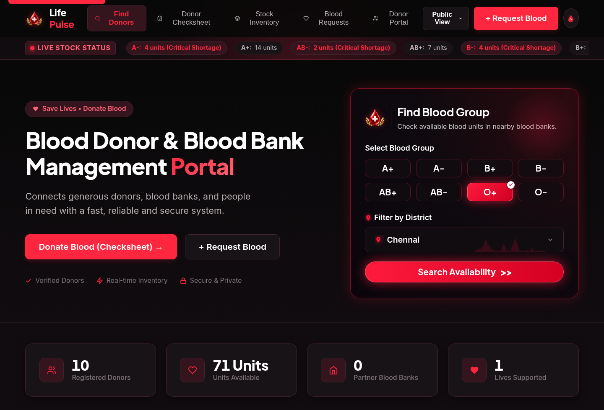

---

### 2. Login Portal & Voluntary Donor Registration
Glassmorphic role-aware sign-in modal with quick **Continue to Public View (Browse Portal)** guest option alongside full 18+ voluntary donor registration onboarding.

| Role-Aware Sign In Portal | Voluntary Donor Registration |
| :---: | :---: |
| 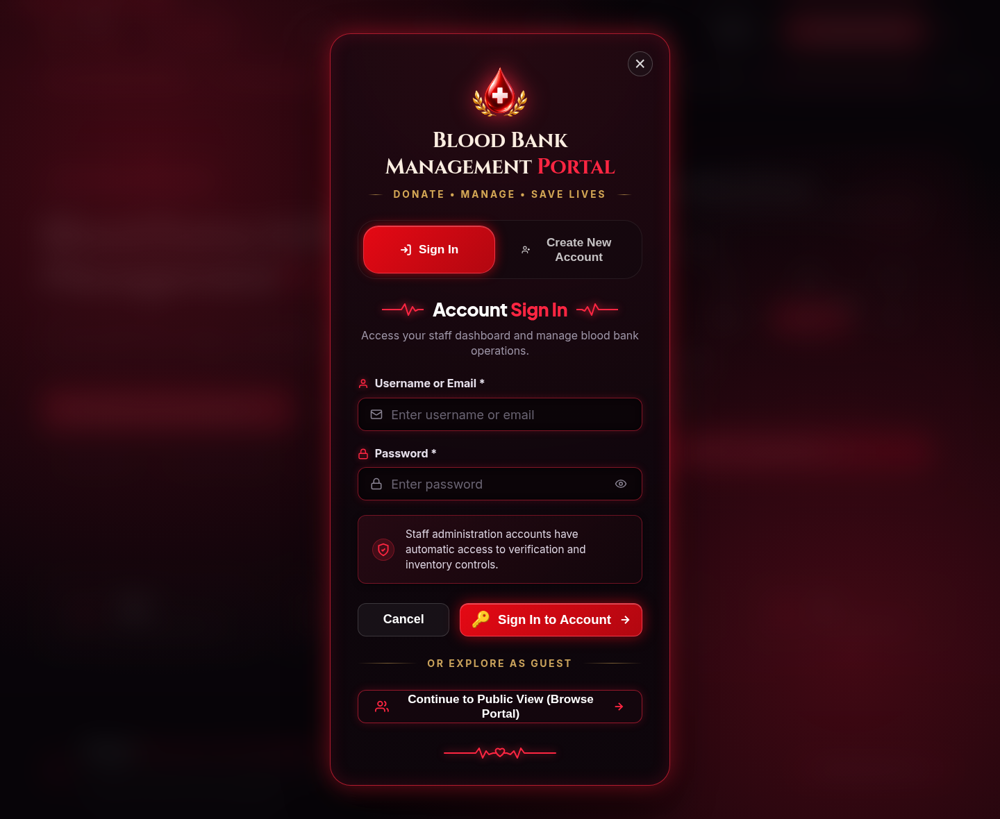 | 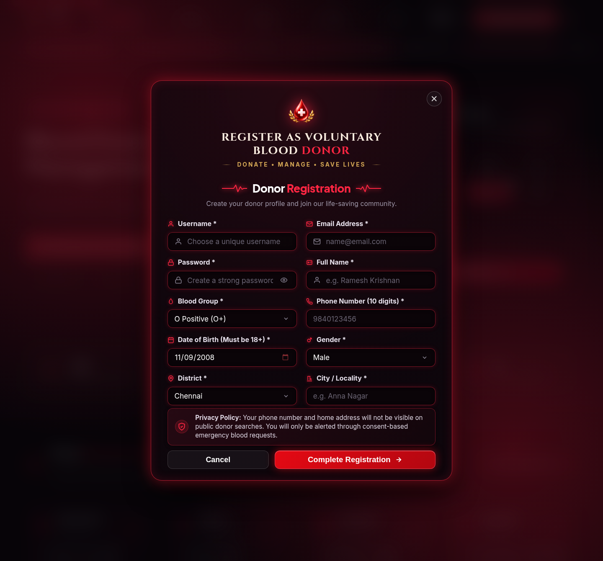 |

---

### 3. Privacy-Preserving Donor Discovery & Checksheet
Public search matches verified voluntary donors across all 38 districts while protecting phone numbers and home addresses behind consent-driven requisition workflows.

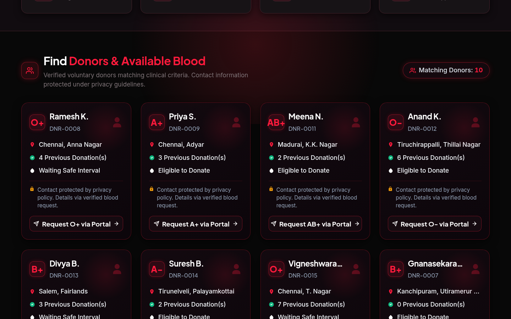

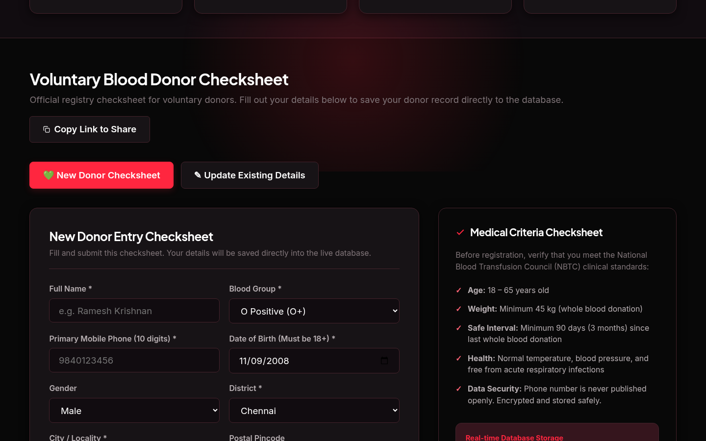

---

### 4. Voluntary Donor Portal & Walk-In Donation Logging
Registered donors manage real-time emergency availability, track the clinical 90-day safe recovery interval, and log walk-in blood donations (`PENDING` until verified by staff).

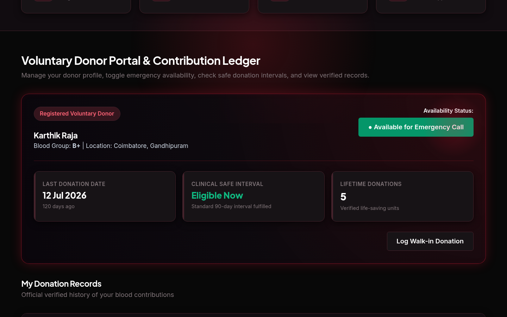

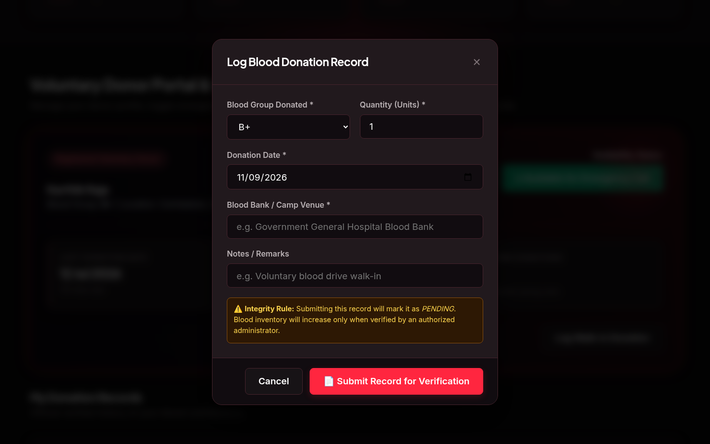

---

### 5. Blood Stock Inventory & Emergency Request Lifecycle
Live stock matrix monitoring 8 blood groups with automated `< 5 units` low-stock alerts alongside end-to-end emergency requisition workflow tracking (`SUBMITTED` -> `UNDER REVIEW` -> `APPROVED` -> `FULFILLED`).

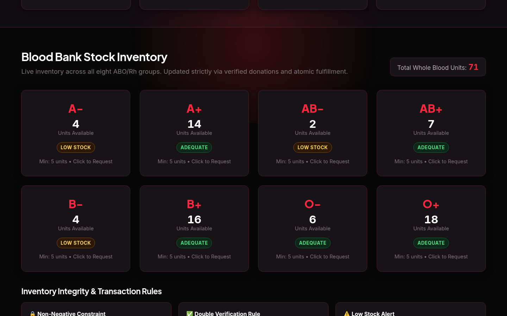

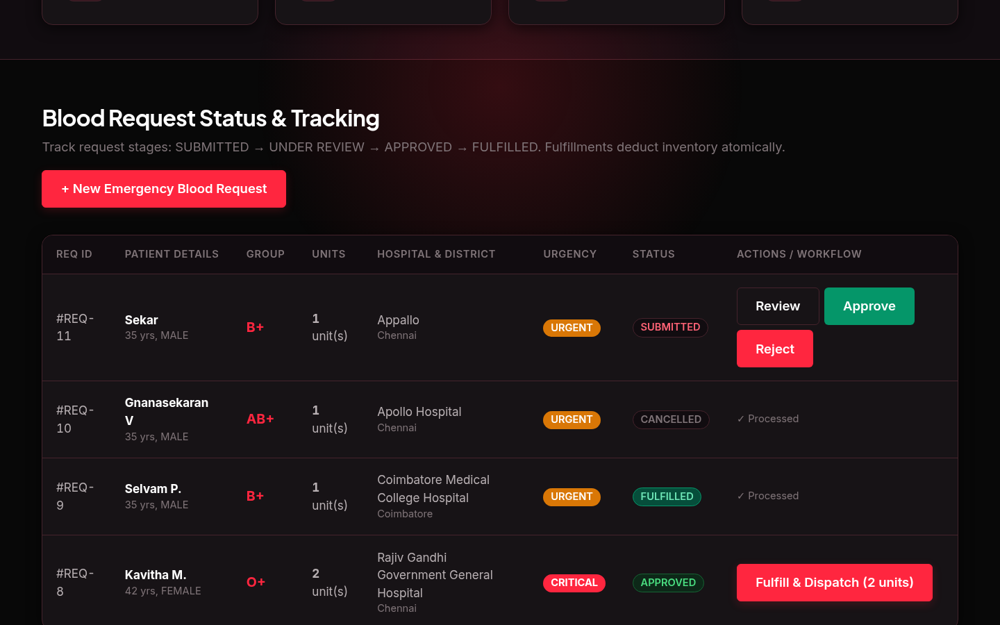

---

### 6. Staff Administrator Console & Audit Trail
Strictly authentication-gated console providing real-time statewide operational metrics, a clinical donation verification queue, and an immutable compliance log.

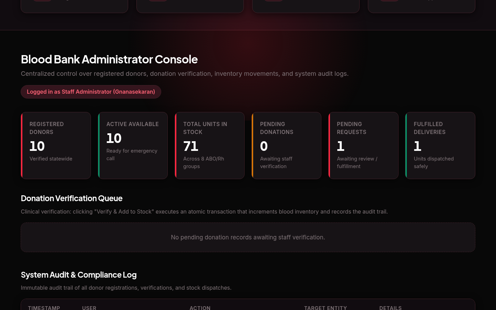

---

### Quick Access Links

| Resource | Purpose | Live Link |
| :--- | :--- | :--- |
| **Live Web Application** | Deployed Single-Page Application (Dark & Light Themes) | [**https://lifepulse-ivory.vercel.app/**](https://lifepulse-ivory.vercel.app/) |
| **REST API Gateway** | Django REST Framework API Directory | [**`https://blood-bank-portal-backend.onrender.com/api/`**](https://blood-bank-portal-backend.onrender.com/api/) |
| **Service Health Monitor** | Lightweight Zero-DB Readiness Probe for UptimeRobot | [**`https://blood-bank-portal-backend.onrender.com/health/`**](https://blood-bank-portal-backend.onrender.com/health/) |
| **Source Repository** | GitHub Monorepo (`frontend/`, `backend/`, `docs/`) | [**View on GitHub**](https://github.com/vgnanasekaran007-hub/Blood-Bank-Management-Portal) |

</div>

---

## Project Overview

**LifePulse** is an end-to-end blood donor registry and emergency inventory coordination platform engineered for clinical workflows across **all 38 districts of Tamil Nadu**. Rather than relying on static sheets or delayed manual calls, LifePulse enforces real database rules for donor eligibility, privacy masking, clinical two-step donation verification, and atomic stock deduction during critical hospital requisitions.

### Key Highlights
- **Privacy-Preserving Donor Discovery:** Public blood searches never leak personal phone numbers, email addresses, or exact home addresses—displaying anonymized donor codes (`DNR-XXXX`), verification badges, district/locality context, and 90-day safe interval eligibility.
- **Clinical Double-Verification Gate:** Voluntary walk-in donations submitted by donors enter `PENDING` status and only increment live inventory after an accredited Staff Administrator verifies and accepts them into stock.
- **Atomic Inventory Protection:** Blood stock deductions during emergency dispatch execute inside atomic database transactions with PostgreSQL row-level locking (`select_for_update()`) and `CHECK (units_available >= 0)` constraints.
- **Production Uptime Readiness:** Dedicated zero-DB `/health/` probe (`HTTP 200`, `{"status": "ok", "message": "Blood Bank Backend is running"}`) integrated with UptimeRobot and Render health checks to prevent cold-start downtime without stressing Supabase connection pools.
- **Cross-Origin Bearer & Session Auth:** Works seamlessly across Vercel and Render using token-backed bearer authentication (`SessionTokenAuthentication`) with instant local sign-out and backend token revocation.

---

## Technologies & Architecture Stack

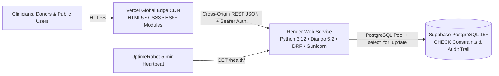

| Layer | Technologies & Libraries | Engineering Role |
| :--- | :--- | :--- |
| **Frontend UI** | **HTML5**, **CSS3**, **Vanilla JavaScript (ES6+ Modules)** (`api.js`, `state.js`, `app.js`) | Semantic SPA architecture, custom Dark & Light clinical themes, glassmorphic modals, custom 38-district searchable dropdown, accessible toast & confirmation dialogs, responsive desktop/tablet/mobile navigation (`360px`–`1536px+`) |
| **Backend Framework** | **Python 3.12**, **Django >= 5.2.0**, **Django REST Framework >= 3.15.0** | Modular REST API, custom `SessionTokenAuthentication`, role-based permissions (`Public`, `Donor`, `Requester`, `Staff Admin`), input validation, and immutable audit logging |
| **CORS & Security** | **`django-cors-headers >= 4.3.0`**, **Vercel Security Headers** (`vercel.json`) | Cross-origin support for `.vercel.app` & `.onrender.com`, `X-Content-Type-Options: nosniff`, `X-Frame-Options: DENY`, SameSite/Secure cookies |
| **Database Layer** | **Supabase PostgreSQL 15+**, **`psycopg2-binary >= 2.9.9`**, **`dj-database-url >= 2.1.0`** *(SQLite fallback locally)* | Relational schema across 7 core tables, TCP keepalive tuning (`conn_max_age=60`, `conn_health_checks=True`), `CHECK (units_available >= 0)` guard |
| **WSGI & Cloud Hosting** | **Gunicorn >= 21.2.0** (`--workers 2 --threads 4 --timeout 30`), **Render** (`render.yaml`), **Vercel** | Multi-threaded production API hosting in Singapore (`singapore` region) paired with Vercel edge frontend routing |
| **Monitoring & Testing** | **UptimeRobot**, **Django `TestCase` (`12` tests)**, **Playwright (Chromium)** | 24/7 `/health/` monitoring, full module + concurrency test suite, and multi-viewport E2E browser regression verification |

---


## Core Modules & Clinical Integrity Guarantees

| Module | Capabilities & Business Rules |
| :--- | :--- |
| **1. Donor Registration & Profile** | • Validates 10-digit phone numbers, mandatory ABO/Rh blood group, and 18–65 age range.<br>• Tracks 90-day safe inter-donation interval and real-time `Available / Unavailable` status toggle. |
| **2. Blood Group Search & Discovery** | • Instant filtering across 8 blood groups (`A+`, `A-`, `B+`, `B-`, `AB+`, `AB-`, `O+`, `O-`) and 38 Tamil Nadu districts.<br>• Zero exposure of personal phone numbers or exact street addresses in public API payloads. |
| **3. Donation Records Tracking** | • Donors log voluntary walk-in or camp donations.<br>• Strict double-verification gate: records stay `PENDING` until an authenticated staff administrator verifies clinical acceptability and commits units to stock. |
| **4. Blood Stock Inventory** | • Live aggregate balances across all 8 groups with automated `< 5 units` critical shortage banner alerts.<br>• Protected against race conditions and negative counts via `select_for_update()` and DB `CHECK (units_available >= 0)`. |
| **5. Blood Request Status & Lifecycle** | • Emergency requisitions record patient details, hospital, urgency (`NORMAL`, `URGENT`, `CRITICAL`), and 1–10 units required.<br>• Full auditable state machine: `SUBMITTED` -> `UNDER REVIEW` -> `APPROVED` -> `FULFILLED` (or `REJECTED` / `CANCELLED`), writing `InventoryTransaction` and `AuditLog` entries on every dispatch. |

---

## API Endpoints Summary

| Endpoint | Method(s) | Access | Description |
| :--- | :--- | :--- | :--- |
| `/health/` | `GET` | Public | Lightweight zero-DB liveness probe (`{"status": "ok", ...}`) |
| `/api/health/` | `GET` | Public | Full API & database connectivity status check |
| `/api/auth/register/` | `POST` | Public | Voluntary donor & requester account registration |
| `/api/auth/login/` & `/api/auth/logout/` | `POST` | Public / Auth | Credential sign-in issuing bearer token + session revocation |
| `/api/auth/me/` | `GET` | Authenticated | Retrieve current authenticated user profile & role |
| `/api/search/` | `GET` | Public | Filter verified donors by `blood_group`, `district`, and `city` |
| `/api/donors/profile/` | `GET`, `PATCH` | Donor | View profile, update details, and toggle emergency availability |
| `/api/donations/` | `GET`, `POST` | Donor / Admin | Log walk-in donation (`PENDING`) and list donation ledger |
| `/api/donations/{id}/verify/` | `POST` | Staff Admin | Verify or reject donation and atomically increment blood stock |
| `/api/inventory/` | `GET` | Public | Retrieve live unit counts and shortage indicators across 8 groups |
| `/api/requests/` | `GET`, `POST` | Public / Auth | Submit emergency requisitions and track request statuses |
| `/api/requests/{id}/update_status/` | `POST` | Staff Admin | Progress workflow (`REVIEW` / `APPROVED` / `FULFILLED`) with atomic stock deduction |
| `/api/admin/kpis/` & `/api/admin/audit-logs/` | `GET` | Staff Admin | Operational dashboard metrics and immutable audit trail |

---

## Local Development & Automated Testing

### Prerequisites
- Python **3.10+** (tested on **3.12**)
- Modern web browser (Chrome, Firefox, Edge, Safari)

### 1. Start the Django Backend (`http://127.0.0.1:8000`)
```bash
git clone https://github.com/vgnanasekaran007-hub/Blood-Bank-Management-Portal.git
cd Blood-Bank-Management-Portal/backend

python3 -m venv .venv
source .venv/bin/activate
pip install -r requirements.txt

python3 manage.py migrate
python3 seed_data.py
python3 manage.py runserver 127.0.0.1:8000
```
*(Uses SQLite automatically when `DATABASE_URL` is unset, or connects directly to Supabase PostgreSQL when `DATABASE_URL` is configured via `.env`.)*

### 2. Start the Frontend (`http://localhost:3000`)
```bash
cd ../frontend
python3 -m http.server 3000
```
Open **`http://localhost:3000`** in your browser.

### 3. Run Backend Integration Test Suite
```bash
cd backend
python3 manage.py test bloodbank
```
Verified **12/12 integration tests** covering `/health/`, `/api/health/`, registration & checksheet date validation, privacy-masked search, double-verification stock increments, atomic fulfillment stock deductions, negative-stock prevention (`CHECK` / row-lock guard), guest emergency requisitions, and Bearer token logout revocation.

---

## Academic & Documentation References

- **Course:** CCS375 – Web Technologies (Academic Year 2026–2027, Team 1)
- [**Official Mini-Project Report (6-Chapter Department Structure)**](docs/CCS375_Team1_Project_Report.md)
- [**REST API Documentation**](docs/API_DOCUMENTATION.md)
- [**Production Deployment Guide (GitHub -> Vercel -> Render -> Supabase)**](docs/DEPLOYMENT_GUIDE.md)

---

## Developer Details

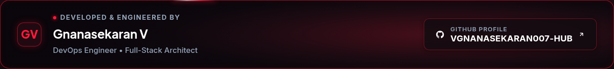

<div align="center">

| Developer | Role & Specialization | GitHub Profile | Live Project |
| :--- | :--- | :--- | :--- |
| **Gnanasekaran V** | DevOps Engineer • Full-Stack Architect | [**`@vgnanasekaran007-hub`**](https://github.com/vgnanasekaran007-hub) | [**View LifePulse Live ↗**](https://lifepulse-ivory.vercel.app/) |

</div>
